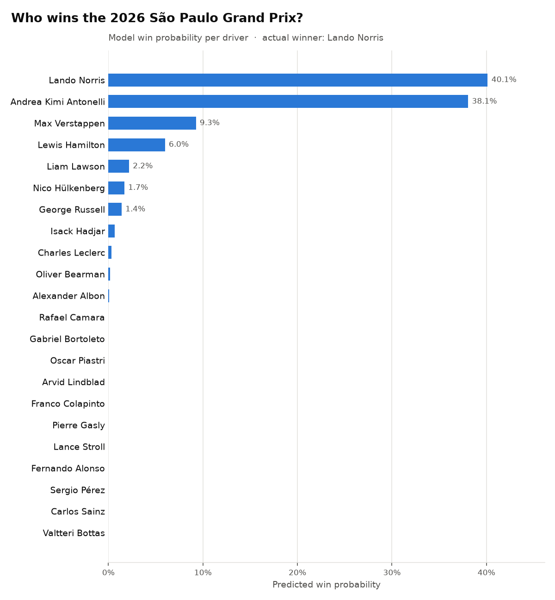

# F1 Race Winner Predictor

Siapa yang bakal menang balapan F1 berikutnya? Proyek ini menebak peluang menang
tiap pembalap pakai data hasil balapan dari FastF1 (musim 2022–2026). Hasilnya
bisa disimpan sebagai tabel Excel dan grafik PNG, atau langsung dilihat di web
app lokal.



## Cara kerjanya

1. **Data.** Hasil semua balapan sejak 2022 (pembalap, tim, posisi start,
   posisi finis, poin), diambil lewat [FastF1](https://docs.fastf1.dev/).
2. **Fitur.** Dihitung untuk tiap pembalap di tiap balapan, dan cuma dari
   balapan *sebelumnya*. Jadi model nggak pernah "ngintip" hasil yang belum
   terjadi.

   | Fitur | Artinya |
   |---|---|
   | `grid` | posisi start (start dari pit lane dihitung paling belakang) |
   | `driver_form_rank` | peringkat pembalap di balapan ini, berdasarkan rata-rata posisi finisnya di 5 balapan terakhir |
   | `team_form_rank` | peringkat tim di balapan ini, berdasarkan rata-rata poin tim di 5 balapan terakhir |
   | `driver_wins_10` | jumlah kemenangan pembalap di 10 balapan terakhirnya |

   Form pembalap dan tim sengaja dibuat dalam bentuk peringkat terhadap
   pembalap lain di balapan yang sama, bukan angka mentah. Alasannya, kalau
   peta kekuatan berubah drastis (misalnya karena regulasi baru 2026),
   peringkatnya tetap masuk akal. Tim yang ganti nama dianggap satu tim
   (Alfa Romeo → Sauber → Audi, AlphaTauri → RB, dan seterusnya), jadi
   performanya tetap nyambung dari musim ke musim.
3. **Model.** Ada tiga yang dicoba: LogisticRegression, RandomForest, dan
   GradientBoosting. Semuanya dilatih dengan data 2022–2024, lalu diuji di 2025
   dan 2026. Data dibagi berdasarkan waktu, bukan acak, supaya ujiannya jujur.
   Model terbaik di 2025 yang disimpan, sedangkan 2026 sengaja dibiarkan
   sebagai ujian tambahan yang nggak ikut dipakai untuk memilih model.
4. **Prediksi.** Peluang dari model dinormalisasi supaya totalnya 100% untuk
   satu balapan.

## Instalasi

Butuh Python 3.11 ke atas (dikembangkan di 3.13).

```bash
cd ~/f1-ml
python3 -m venv venv
source venv/bin/activate
pip install -r requirements.txt
```

FastF1 menyimpan cache unduhan di `./cache`, dan data mentah masuk ke
`data/raw/`. Dua-duanya nggak ikut masuk git.

## Cara pakai

Jalankan dari folder proyek dengan venv aktif, urutannya begini:

```bash
python src/fetch_data.py                       # 1. unduh hasil balapan       -> data/raw/results.csv
python src/features.py                         # 2. bikin fitur               -> data/features.csv
python src/baseline.py                         # 3. baseline "pole pasti menang" untuk 2025 dan 2026
python src/train.py                            # 4. latih dan bandingkan model -> data/model.joblib
python src/predict.py --year 2026 --round 20   # 5. prediksi satu balapan     -> outputs/prediction_2026_20.csv
python src/export.py  --year 2026 --round 20   # 6. Excel + grafik            -> outputs/prediction_2026_20.xlsx/.png
streamlit run src/app.py                       # web app di http://localhost:8501
```

Beberapa hal yang perlu kamu tahu:

- `fetch_data.py` cuma mengunduh balapan yang belum ada di `results.csv`, jadi
  aman dijalankan berkali-kali. Mau coba satu balapan dulu? Pakai
  `python src/fetch_data.py --test`.
- **Balapan yang belum jalan**: tunggu kualifikasi selesai, lalu jalankan
  `predict.py` untuk ronde itu. Grid start-nya diambil dari urutan kualifikasi.
  Untuk balapan yang sudah lewat, `--from-qualifying` melakukan hal yang sama
  dan hasilnya disimpan di file `_quali` terpisah.
- **Lewat web app**: ada tiga tab, yaitu hasil balapan, rekap musim, dan
  prediksi. Tab *Prediction* bisa memprediksi balapan yang dipilih di sidebar
  (bisa juga pakai grid dari kualifikasi) atau balapan yang akan datang.
  Hasilnya muncul sebagai grafik peluang menang, dan file CSV, Excel, serta
  PNG-nya bisa langsung diunduh. Tab ini butuh model yang sudah dilatih
  (langkah 2 dan 4).
- **Setelah ada balapan baru**: jalankan lagi langkah 1, 2, dan 4 supaya data
  dan modelnya ikut update.
- Semua script punya `--help`.

## Hasil

- **Akurasi**: pilihan teratas model benar-benar menang.
- **Top-3**: pemenang aslinya ada di tiga besar versi model.
- **Baseline**: tebakan paling sederhana, "yang start dari pole pasti menang".

| Model | Akurasi 2025 | Top-3 2025 | Akurasi 2026 | Top-3 2026 |
|---|---|---|---|---|
| Baseline (pole menang) | **66,7%** | 95,8% | **70,0%** | 90,0% |
| LogisticRegression | 37,5% | 91,7% | 40,0% | 90,0% |
| **RandomForest** (disimpan) | 45,8% | **100,0%** | 60,0% | **95,0%** |
| GradientBoosting | 33,3% | 83,3% | 65,0% | 90,0% |

2025 berisi 24 balapan, 2026 berisi 20 balapan (sampai GP São Paulo). Semua
model dilatih dengan data 2022–2024.

**Cara bacanya:** kalau cuma mau nebak satu nama pemenang, pembalap di pole
masih tebakan terbaik. Kelebihan model ada di daftar pendeknya. Tiga teratas
versi model selalu berisi pemenangnya di semua balapan 2025, dan di 19 dari 20
balapan 2026. Itu lebih bagus daripada sekadar ambil tiga teratas di grid.

## Keterbatasan

- **Data ujinya kecil.** Satu balapan itu sekitar 4–5% dari satu musim, jadi
  selisih tipis antarmodel belum tentu berarti apa-apa.
- **Belum bisa mengalahkan pole position untuk nebak pemenang persis.** Fitur
  yang ada nggak bisa tahu kapan pembalap di pole bakal gagal menang, entah
  karena strategi, safety car, mobil bermasalah, cuaca, atau insiden di lap
  pertama.
- **Sinyalnya masih sedikit.** Belum ada selisih waktu kualifikasi, hasil latihan
  bebas atau sprint, strategi ban, cuaca, karakter sirkuit, maupun data
  keandalan mobil.
- **Grid dari kualifikasi belum termasuk penalti.** Untuk balapan yang belum
  jalan, grid diambil dari urutan kualifikasi. Penalti grid yang dijatuhkan
  setelahnya nggak ikut dihitung.
- **Perubahan regulasi.** Model dilatih dengan data 2022–2024, padahal regulasi
  2026 mengocok ulang urutan tim. Akibatnya, di awal 2026 data form butuh
  beberapa balapan dulu sebelum menyusul kondisi sebenarnya.
- **Nama tim baru** harus ditambahkan ke `TEAM_KEYS` di `src/features.py`.
  Script-nya bakal kasih peringatan kalau ketemu nama yang belum dikenal.
- **Batas API.** FastF1 cuma mengizinkan sekitar 500 panggilan API per jam, dan
  unduhan pertama yang lengkap bisa kena batas ini. Kalau itu terjadi,
  `fetch_data.py` menyimpan data yang sudah didapat, tinggal dijalankan lagi
  nanti.
- **Nggak perlu akun F1.** Script-nya mematikan login akun F1 bawaan FastF1
  (tanpa itu, terminal bakal minta email dan password). Hasil balapan dan
  kualifikasi diambil dari API Jolpica/Ergast yang nggak butuh akun.

## Struktur proyek

```
src/fetch_data.py   unduh hasil balapan lewat FastF1
src/features.py     bikin fitur tanpa bocoran data masa depan, plus pengeceknya
src/baseline.py     baseline pole position
src/train.py        latih model berdasarkan waktu, bandingkan, simpan yang terbaik
src/predict.py      peluang menang tiap pembalap untuk satu balapan
src/export.py       tabel .xlsx yang sudah diformat dan grafik .png
src/app.py          web app Streamlit
PLAN.md             rencana pembuatan proyek, langkah demi langkah
```
